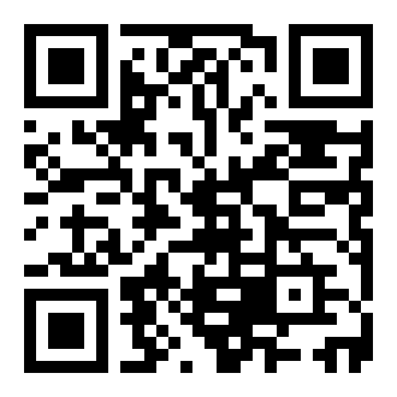
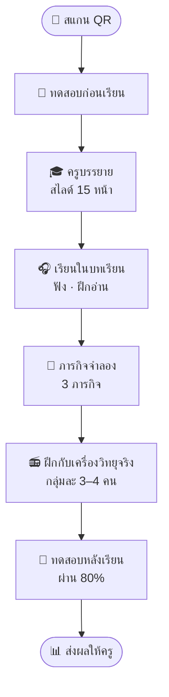

# 📻 ระเบียบการวิทยุโทรศัพท์

### บทเรียนออนไลน์ · สื่อการสอน · แบบทดสอบก่อน-หลังเรียน

วสว.กศ.รร.ส.สส. · ผู้สอน จ.วรากร

**สแกนด้วยมือถือ** · ใช้ได้ทั้ง Android และ iPhone · ไม่ต้องติดตั้งแอป · ไม่ต้องล็อกอิน

---

## ✨ มีอะไรในบทเรียน

| ส่วน | รายละเอียด |
|---|---|
| 🎧 **ฟังเสียงตัวอย่าง** | ปุ่ม ▶ ฟัง อ่านข้อความวิทยุเป็นภาษาไทย ปรับความเร็วได้ (ช้ามาก / ช้า / ปกติ) |
| 📝 **ทดสอบก่อนเรียน** | 10 ข้อ รู้พื้นฐานก่อนเริ่มสอน |
| 🧭 **9 บทเรียน (~75 นาที)** | ความสำคัญ · หลักการ · การออกเสียง · Proword · การเรียกขาน · ข่ายและ สบข. · ข่าวและแบบบันทึก · ความปลอดภัย |
| 🎯 **ภารกิจจำลอง 3 ภารกิจ** | ซ้อมเปิดข่าย ส่งข่าว ห้ามใช้/เริ่มใช้ และปิดข่าย ได้ดาวตามความถูกต้อง |
| 🏅 **ทดสอบหลังเรียน + ใบรายงานผล** | สุ่ม 12 จาก 21 ข้อ ผ่านเมื่อ 80% พร้อมรหัสยืนยัน เทียบคะแนนก่อน-หลัง |
| 📊 **ส่งผลให้ครู** | กดปุ่มเดียว ข้อมูลเข้า Google Form และชีตสรุปผลอัตโนมัติ |

## 🗺️ ลำดับการเรียน

## 🧰 ชุดสื่อทั้งหมด

| สื่อ | ใช้ที่ไหน | ไฟล์ |
|---|---|---|
| 🌐 บทเรียนออนไลน์ | มือถือนักเรียน | [`index.html`](index.html) |
| 🖥️ สไลด์ประกอบการสอน 15 หน้า | จอโปรเจกเตอร์ | [`slides/`](slides) |
| 📄 ใบสรุป A4 | บนโต๊ะนักเรียน | [`print/ใบสรุประเบียบการวิทยุโทรศัพท์.pdf`](print/ใบสรุประเบียบการวิทยุโทรศัพท์.pdf) |
| 🧾 ใบขั้นตอนสำหรับนักเรียน (มี QR) | แจกต้นคาบ | [`print/ใบขั้นตอนสำหรับนักเรียน.pdf`](print/ใบขั้นตอนสำหรับนักเรียน.pdf) |
| 📌 แผ่นป้ายเปิด-ปิดข่าย | ข้างเครื่องวิทยุ | [`print/แผ่นป้ายขั้นตอนเปิด-ปิดข่าย (ฉบับปรับปรุง).pdf`](print/แผ่นป้ายขั้นตอนเปิด-ปิดข่าย%20(ฉบับปรับปรุง).pdf) |
| 🗓️ แผนการสอน 3 คาบ | ครู | [`docs/lesson-plan.md`](docs/lesson-plan.md) |

## ⏱️ แผนสอนโดยย่อ (3 คาบ × 50 นาที)

| คาบ | เนื้อหา |
|:-:|---|
| **1** | ทดสอบก่อนเรียน → ความสำคัญและหลักการ → การอ่านตัวเลข หมู่วันเวลา ตัวอักษรเสียงพ้อง |
| **2** | Proword และการเรียกขาน → ข่าย สบข. เปิด-ปิดข่าย → ห้ามใช้/เริ่มใช้ ความเร่งด่วน ความปลอดภัย |
| **3** | ภารกิจจำลอง → ฝึกเครื่องจริง → ทดสอบหลังเรียน → ทบทวนข้อที่ผิดบ่อย |

รายละเอียดเต็มดู [`docs/lesson-plan.md`](docs/lesson-plan.md)

## 🛠️ สำหรับผู้ดูแล

โครงสร้างโฟลเดอร์และวิธีสร้างไฟล์ใหม่

| ที่ | คืออะไร |
|---|---|
| `index.html` | บทเรียนที่เผยแพร่ผ่าน GitHub Pages (ไฟล์เดียว) |
| `src/lesson-src.html` | ต้นฉบับบทเรียน (มีตัวแทน `{{QR}}`) สร้าง `index.html` ด้วย `python3 build.py` |
| `src/cheatsheet.html` `student.html` `placard.html` | ต้นฉบับใบสรุป ใบขั้นตอนนักเรียน แผ่นป้าย (ฟอนต์ Kanit / IBM Plex Sans Thai) |
| `print/` | PDF พร้อมพิมพ์ |
| `qr/` | QR ของลิงก์บทเรียน |
| `slides/` | ต้นฉบับสไลด์ (deck.json + slides/*.html) |

**ข้อควรทำ**
- ถ้าเปลี่ยนที่อยู่บทเรียน ต้องสร้าง QR ใหม่ และเปลี่ยนใน `print/` และสไลด์หน้าสุดท้าย
- เสียงภาษาไทยของปุ่ม ▶ ฟัง ขึ้นกับเครื่องผู้เรียน แนะนำ **Microsoft Edge** (คอมพิวเตอร์) · Android: ติดตั้งข้อมูลเสียงไทยใน Google Text-to-speech · iPhone: ตั้งค่า › การช่วยการเข้าถึง › เนื้อหาที่พูด › เสียง
- สไลด์หน้า "finish" แทนรูป QR เป็นลิงก์ใหม่แล้ว (20 พ.ย. 2569) ไฟล์ใน `slides/` อาจยังอ้างรูปเดิม ให้ถือเวอร์ชันบน Claude เป็นหลัก

---

สร้างและปรับปรุงร่วมกับ Claude · เนื้อหาอ้างอิงระเบียบการวิทยุโทรศัพท์ของหลักสูตร ให้ตรวจทานก่อนใช้สอนทุกครั้ง

